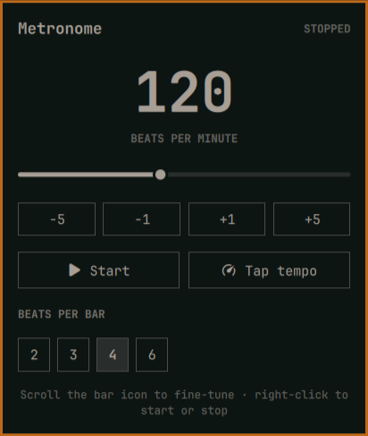

# Metronome

A small, low-latency metronome for the Omarchy bar. It generates its click
locally through PipeWire and does not use the network.



## Install

```bash
omarchy plugin add https://github.com/dlpwaters/omarchy-metronome.git --enable --yes
```

## Use

- Left-click the bar icon to open the controls.
- Choose a tempo from 30–240 BPM with the slider or step buttons.
- Use **Tap tempo** to measure a rhythm.
- Choose 2, 3, 4, or 6 beats per bar. The first beat is accented.
- Right-click the bar icon to start or stop without opening the panel.
- Scroll over the bar icon to change the tempo one BPM at a time.

With the panel open, Left/Right changes one BPM, Up/Down changes five BPM,
Space starts or stops, and `T` taps the tempo.

The audio engine uses Python's standard library and `pw-play`, both included
on Omarchy. It falls back to `aplay` when PipeWire's player is unavailable.

## Dependencies and permissions

- Python 3
- `pw-play` from PipeWire, with `aplay` as a fallback

The plugin runs entirely as your desktop user. It needs no network access,
API keys, background service, installer, or elevated privileges. It does not
overwrite user configuration; Omarchy manages its bar placement and settings.

## Terminal control

```bash
omarchy-shell dlpwaters.metronome open
omarchy-shell dlpwaters.metronome play
omarchy-shell dlpwaters.metronome stop
```

## Remove

```bash
omarchy plugin remove dlpwaters.metronome
```
